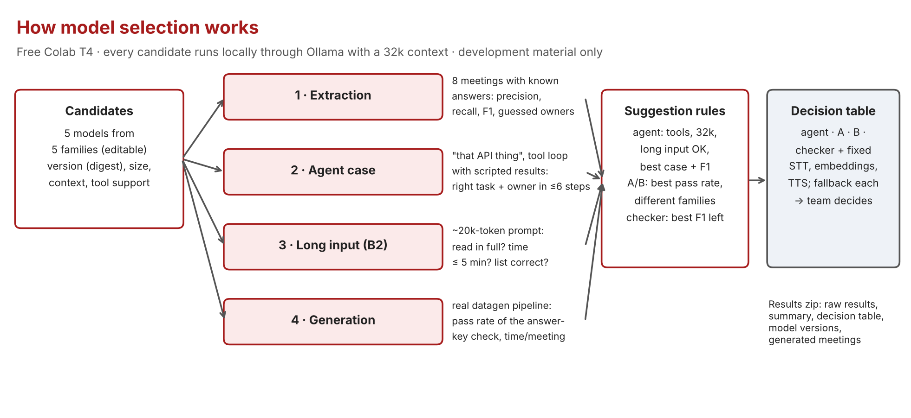

# Model selection

*Generated by `eval/model_selection.py` on 2026-11-21. Hardware: Tesla T4, 15360 MiB. Execution mode: live (Ollama). Repeats per test: 1.*

This answers item 1 of the instructor's feedback on the design document ("Name your models ... with versions. Say whether the generation models come from different families") and fills in the Week 9 model-selection decision table.

## Suggested choice (the team decides)

| Role | Model | Family | Version (digest) |
|---|---|---|---|
| Agent (extraction, agent loop, B2) | qwen3:8b | Qwen (Alibaba) | 500a1f067a9f782620b40bee6f7b0c89e17ae61f686b92c24933e4ca4b2b8b41 |
| Generator A (development data) | mistral-nemo:12b | Mistral (Mistral AI) | e7e06d107c6c86ed0cf45445f1790720b5092149c4c95f4d965844e9afbfdc89 |
| Generator B (test data) | gemma3:12b | Gemma (Google) | b92b218582c521ba287f38f1d6057dcd3c6cbff036f13cac97b5d861f5e58ec3 |
| Checker (answer-key check iv) | llama3.1:8b | Llama (Meta) | 46e0c10c039e019119339687c3c1757cc81b9da49709a3b3924863ba87ca666e |

- Generators A and B come from different families: **yes**.
- Neither generator is the agent's model or from the agent's family: **yes**.
- **Team decision:** see *Reading of the results (by hand)* at the end.

**Suggestion rules** (fixed before the results were seen):
- **Agent:** must support tools, have a context of at least 32768 tokens, read the ~20k-token B2 prompt in full and finish it within 5 minutes. Then the highest agent-case solve rate, then extraction F1, then speed.
- **Generator A:** the highest answer-key-check pass rate after three tries, then first-try pass rate, then speed. It must not be the agent model or from its family.
- **Generator B:** the best remaining model from a family different from A and from the agent.
- **Both generators:** must pass the answer-key check in at least one meeting (added after run 1, where a model with a 0% pass rate was suggested only because it was faster).
- **Checker:** the best extraction F1 among the remaining models.

## Decision table (Week 9)

| role | model | version (digest) | task | reasoning depth | privacy | latency | cost | local/free | fallback |
|---|---|---|---|---|---|---|---|---|---|
| agent (extraction, agent loop, B2) | qwen3:8b | 500a1f067a9f782620b40bee6f7b0c89e17ae61f686b92c24933e4ca4b2b8b41 | find task changes; choose tools step by step | medium: several tool steps | local (Ollama); no data leaves the machine | 7.0 s per extraction; 45.3 s for a ~20k-token B2 prompt | 0 (local) | yes: free Colab T4 or laptop | mistral-nemo:12b |
| generator A (development data) | mistral-nemo:12b | e7e06d107c6c86ed0cf45445f1790720b5092149c4c95f4d965844e9afbfdc89 | write development meetings from a scenario | low: follows a script | local (Ollama); no data leaves the machine | 54.6 s per meeting | 0 (local) | yes: free Colab T4 or laptop | gemma3:12b |
| generator B (test data) | gemma3:12b | b92b218582c521ba287f38f1d6057dcd3c6cbff036f13cac97b5d861f5e58ec3 | write test meetings from a scenario | low: follows a script | local (Ollama); no data leaves the machine | 79.8 s per meeting | 0 (local) | yes: free Colab T4 or laptop | llama3.1:8b |
| checker (answer-key check iv) | llama3.1:8b | 46e0c10c039e019119339687c3c1757cc81b9da49709a3b3924863ba87ca666e | list the changes in a generated meeting | low | local (Ollama); no data leaves the machine | 8.2 s per meeting | 0 (local) | yes: free Colab T4 or laptop | granite3.3:8b |
| speech-to-text | faster-whisper (size to be chosen) |  | audio to transcript |  | local |  | 0 | yes (CPU) | Parakeet TDT 0.6B v2 on a free Colab GPU (stretch 1) |
| retrieval comparison | nomic-embed-text v1.5 |  | compared with BM25 on the development set only |  | local |  | 0 | yes | BM25 only |
| text-to-speech (held-out audio) | Kokoro-82M |  | audio of the held-out synthetic projects |  | local |  | 0 | yes | transcript condition only |

## Results per model

| model | family | context_length | extract_precision | extract_recall | extract_f1 | extract_guessed_owner | extract_valid_json | extract_median_s | tools_supported | agent_solved_rate | agent_ends | long_read_in_full | long_seconds | long_tasks_correct | gen_first_try_pass | gen_pass_after_3 | gen_seconds_per_meeting |
|---|---|---|---|---|---|---|---|---|---|---|---|---|---|---|---|---|---|
| qwen3:8b | Qwen (Alibaba) | 40960 | 0.621 | 0.621 | 0.621 | 0 | 1.0 | 7.0 | True | 1.0 | propose_update | True | 45.3 | 5/10 | 0.2 | 1.0 | 33.7 |
| llama3.1:8b | Llama (Meta) | 131072 | 0.395 | 0.517 | 0.448 | 0 | 1.0 | 8.2 | True | 0.0 | ask_clarification | True | 45.2 | 4/10 | 0.2 | 0.8 | 37.2 |
| gemma3:12b | Gemma (Google) | 131072 | 0.724 | 0.724 | 0.724 | 0 | 1.0 | 21.9 | False | 0.0 | error | True | 64.1 | 4/10 | 0.4 | 0.8 | 79.8 |
| mistral-nemo:12b | Mistral (Mistral AI) | 1024000 | 0.567 | 0.586 | 0.576 | 0 | 1.0 | 12.1 | True | 0.0 | no_tool_call | True | 54.6 | 2/10 | 0.6 | 0.8 | 54.6 |
| granite3.3:8b | Granite (IBM) | 131072 | 0.44 | 0.379 | 0.407 | 0 | 1.0 | 9.1 | True | 0.0 | no_tool_call | True | 54.3 | 4/10 | 0.2 | 0.6 | 29.4 |

Failure reasons in the generation test: qwen3:8b: ambiguity_not_real 1; missing_event 1; missing_owner_or_date_cue 1; tag_leak 1; unscripted_change 3; llama3.1:8b: missing_event 5; missing_owner_or_date_cue 3; gemma3:12b: missing_event 2; missing_owner_or_date_cue 2; tag_leak 5; mistral-nemo:12b: missing_event 3; missing_owner_or_date_cue 1; tag_leak 2; unscripted_change 1; granite3.3:8b: missing_event 4; missing_owner_or_date_cue 6; tag_leak 1

## What these results do and do not show

- Only development material was used: the hand-written demo project and generated development projects. The test set was not touched.
- Extraction was measured on 8 short meetings; 5 of them were written by fixed templates, so their language is simpler than real or LLM-written meetings.
- The agent case is one case with scripted tool results; it tests tool choice, not the full system.
- The generation test wrote 5 meetings of one development project per model; check (iv) was done by: qwen3:8b. Flagged changes are saved in `generation.jsonl` ("problems") for manual review.
- The long-input test is one synthetic prompt of about 20,000 tokens.
- The per-meeting time limit (5 minutes) will be measured again with the real agent loop before the system freeze.
- All numbers are from live runs on the hardware above, with the model versions (digests) listed.

## Run history

- **Run 1 (21 Nov 2026):** each generator had a different checker for check (iv) and change types had to match exactly. Most generated meetings failed on false "unscripted change" flags, so generator B could not be chosen.
- **Run 2 (21 Nov 2026):** one fixed checker for every generator; `create`, `assign` and `set_due_date` count as one kind of change; repeating the existing task list is not flagged; every flag is saved for review by hand; 5 generated meetings; a generator must pass at least one meeting. The numbers in this report are from this run.

## Reading of the results (by hand)

*Written by WS3 (Gözde Nur Özdemir) after run 2, 21 Nov 2026.*

**Team decision (WS3 proposal; to be confirmed by the team):** the suggestion is accepted as it is.

| Role | Model | Family | Why |
|---|---|---|---|
| Agent | `qwen3:8b` | Qwen (Alibaba) | The only model that solved the agent case (right task and owner within 6 steps). Extraction F1 0.621 with no guessed owners; the ~20k-token B2 prompt was read in full in 45 s. `gemma3:12b` has a higher F1 (0.724) but Ollama reports no tool support for it, so it cannot run the agent loop. |
| Generator A | `mistral-nemo:12b` | Mistral (Mistral AI) | The highest first-try pass rate (3 of 5 meetings) and 4 of 5 after three tries, 55 s per meeting. `qwen3:8b` passed all 5 meetings but cannot be a generator, because it is the agent's model. |
| Generator B | `gemma3:12b` | Gemma (Google) | 4 of 5 meetings after three tries, 2 of 5 on the first try. `llama3.1:8b` also passed 4 of 5 but only 1 on the first try; `granite3.3:8b` passed 3 of 5. |
| Checker (datagen check iv) | `llama3.1:8b` | Llama (Meta) | The best extraction F1 (0.448) among the models that are neither the agent nor a generator. Measured as a checker after run 2 (see below). |

Generators A and B come from different families, and neither comes from the agent's family.

**Manual review of the check (iv) flags.** Run 2 flagged 8 changes (7 in meetings written by `qwen3:8b`, 1 by `mistral-nemo:12b`). All 8 were read in the saved meetings, and all 8 are true flags: the generator added a commitment that the scenario does not have, for example "I'll make sure the endpoints are documented by Tuesday", "I'll also add a feedback form to the login" and "could we maybe add a little loading spinner?". No false flag was found, so the run 1 problem is fixed. Missed changes (false negatives) were not measured.

**Is `llama3.1:8b` good enough as the checker?** In run 2, check (iv) was done by `qwen3:8b`, so the suggested checker was measured separately: `--measure-checker llama3.1:8b` ran check (iv) with it on the same 50 saved meetings (no new meetings were written).

- Of the 4 meetings with a true flag, `llama3.1:8b` flagged 3 and missed 1.
- It flagged 5 meetings that `qwen3:8b` had not flagged. Read by hand: 3 are false (a status remark read as an assignment, "payment gateway integration is lagging"; a due date that is not set; an event label "E14" left in the text read as a task name) and 2 are borderline (a side remark that a query "should be done by end of day"; a request for "the data schema by Friday" with no owner).

A false flag only costs one more try, so it does not harm the data. A missed flag is the risk: an extra change would then be missing from the answer key. We still keep `llama3.1:8b`, because the alternative, `qwen3:8b`, is the agent's model: if the agent's own model decided which test meetings are clean, extra changes that this model cannot see would stay in the test data unnoticed, and the agent would never be penalised for missing them. To cover the missed flags, WS3 reads a sample of the generated test meetings by hand before the freeze. The team decides.

**Other observations**

- Most remaining failures are generator mistakes that checks (i) and (ii) caught: a planned event without its label, or an owner or date that the line does not state. A failed meeting is written again (at most three tries).
- `gemma3:12b` sometimes puts the event label in the middle of a line instead of at the end (for example "By the 1st. [E7] Someone needs to own this."). The label check caught all 5 cases. The parser could also accept a label in the middle of a line.
- With both A and B, one meeting in five failed all three tries. The datagen pipeline therefore needs a clear rule for such a meeting.
- `mistral-nemo:12b` sometimes starts lines with Markdown asterisks ("Ayşe: ** Alright"). The transcript parser should remove them.

**Limits.** One development project of 5 meetings per model and one run. Generation uses temperature 0.8, so pass rates will vary between runs; they are enough to choose the models, not to report data quality.
